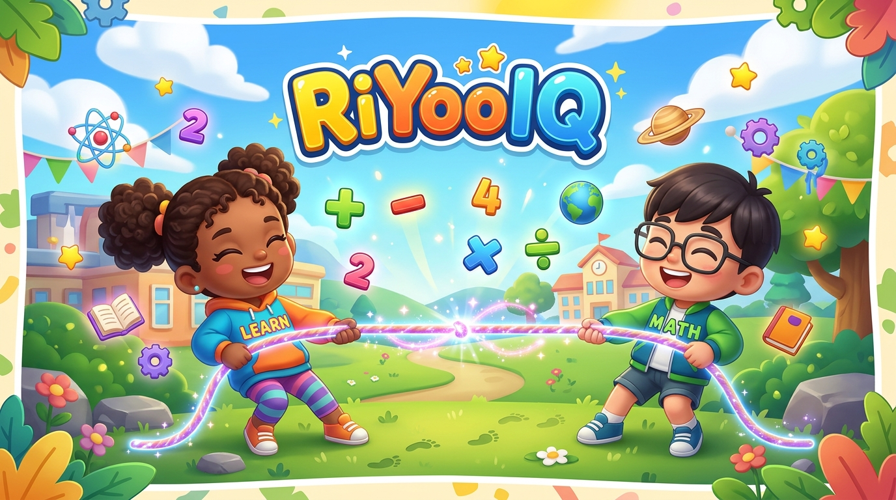

# RiYooIQ - Arena Pertarungan Cerdas Anak Indonesia 🧠⚡

Game edukasi adu pintar matematika dan sains untuk anak-anak dengan arena pertarungan seru (Tarik Tambang, Adu Panco, dan Dorong Tepi Jurang). Dibuat dengan HTML5 Canvas (60 FPS), CSS3 dinamis, dan Web Audio API murni.



## 🎮 Fitur Utama
- **3 Mini-Game Arena Unik**:
  - 🪢 **Tarik Tambang (Tug of War)**: Menjawab benar menarik lawan mendekat ke jurang/garis batas.
  - 💪 **Adu Panco (Arm Wrestling)**: Menjawab benar menekan tangan lawan ke meja.
  - 🏔️ **Dorong Jurang (Cliff Push Battle)**: Saling dorong di tepi tebing!
- **Dua Tema Pembelajaran**:
  - 📐 **Matematika**: Berhitung, pola angka, geometri dasar, dan logika angka.
  - 🔬 **Sains / IPA**: Hewan & tumbuhan, tubuh manusia, tata surya, dan wujud benda.
- **Generator Soal Dinamis (10.000+ Variasi)**:
  - Soal digenerasi otomatis dengan sistem anti-duplikasi pilihan ganda (4 opsi unik & logis).
- **Mode Bermain**:
  - 🤖 **1P vs AI**: Melawan komputer dengan tingkat kesulitan Mudah, Normal, dan Sulit.
  - 👥 **2P Layar Terbagi (Shared Screen)**: Bermain bersama teman di 1 HP (Split-Touch) atau 1 Keyboard (P1: QWER / P2: UIOP).
- **Audio Synthesizer (Web Audio API)**:
  - Musik latar 8-bit ceria dan sound effects (chime benar, buzzer salah, start fanfare, victory fanfare) tanpa memerlukan file audio eksternal.
- **PWA Ready (Offline & Direct Install)**:
  - Mendukung instalasi langsung di Android, iOS, dan Desktop tanpa harus melalui Google Play Store.
  - Berfungsi 100% offline setelah diinstal.

## 🚀 Cara Menjalankan Secara Lokal
Cukup buka `index.html` di browser atau jalankan server lokal:
```bash
# Menggunakan Python
python -m http.server 8080

# Lalu buka http://localhost:8080 di browser
```

## 📱 Struktur Direktori
```text
gamemath/
├── index.html        # Struktur UI utama, audio toggles, HUD, & arena canvas
├── manifest.json     # Konfigurasi PWA (Web App Manifest)
├── sw.js             # Service worker untuk mode offline
├── css/
│   └── style.css     # Design system anak-anak cerah & responsif
├── js/
│   ├── audio.js        # SoundEngine (Web Audio API Synthesizer)
│   ├── questions.js    # QuestionEngine (10.000+ kombinasi soal)
│   ├── canvas-arena.js # CanvasArena (Animasi karakter 60 FPS & partikel)
│   └── game.js         # RiYooGame Controller & State Manager
└── assets/           # Icon & logo resmi RiYooIQ
```
